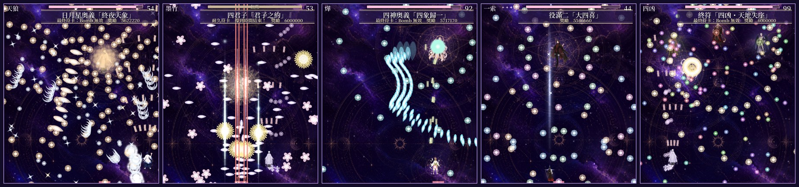
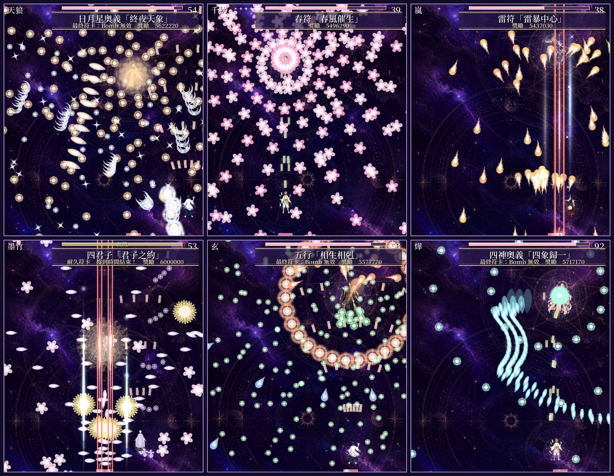
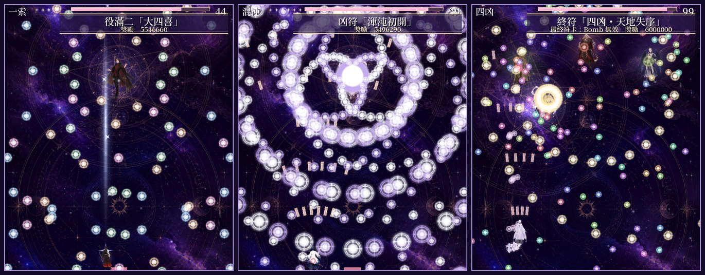
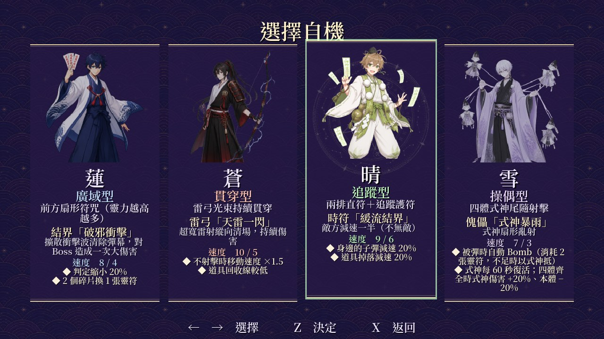
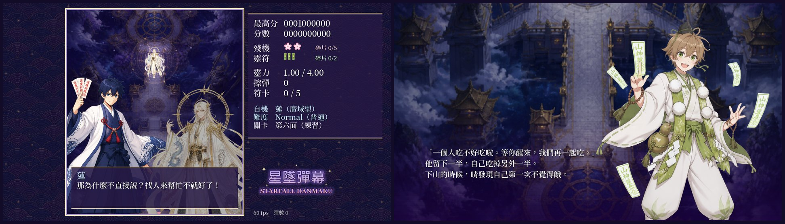
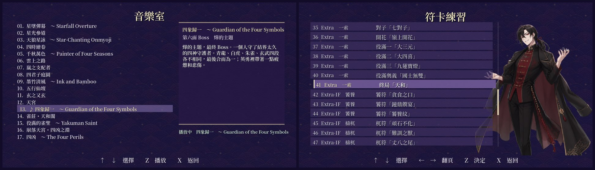

# Starfall Danmaku (星墜彈幕)

**English** · [繁體中文](README.zh-TW.md)

**Starfall Danmaku** is a vertical bullet-hell shooter in the style of Touhou Project. On the Night of the Heaven's Gate, four young men (an exorcist, an archer, a mountain ascetic and a puppeteer) climb to the Heavenly Palace through six stages of spell cards. An Extra stage and an "Extra-IF" route follow, where the hero arrives too late and four ancient beasts break loose.

This is a side project. I designed and directed it, and an AI coding agent, Claude Code, wrote the code: first in Unreal Engine 5.8 (C++), then as a port to Godot 4.6 (C#), which is the version I now play and develop. This page explains what I did, what the AI did, and what the game looks like.

> **About the music.** All 17 songs in the game are AI-generated placeholders. I made them from prompts so I could play the game with music while working on it. I plan to compose every song myself and release an updated version; the rest of the game (the danmaku, the portraits and the sound effects) will most likely stay as it is.

| | |
|---|---|
| **My role** | Game design, spell card design, balance, story direction (a solo side project made with an AI coding agent) |
| **Timeline** | 6–10 November 2026, about five days |
| **Tools** | Godot 4.6 (C#), Unreal Engine 5.8 (C++, first version), Python, Blender; Claude Code, Canva (AI images), an AI music generator |
| **Videos** | Three full runs played by the game's bot, on Lunatic, Extra and Extra-IF: [Releases](../../releases/latest). A playable build isn't public yet. |

## My role and the use of AI

### 1. My own design and decisions

- **The game.** I asked for a Touhou-like STG and set its direction one round of feedback at a time, using Touhou as the shared reference: how spell cards are structured, how Extra stages work, how difficulty should feel.
- **Spell cards.** The four season cards of stage 2 come from a p5.js danmaku prototype of my own. I also designed or redesigned many others in detail, for example:
  - **終局「天和」 (Tenhou)**, the Extra boss's last card, in three phases like the final boss's last card: rings of mahjong tiles from the top (half of each ring flies off into the sky), then a row of tiles rising from the bottom at random spots, then a clockwise spiral; the card's title grows to 「天和」「地和」「人和」 as each hand joins. The timer only starts once the boss is down to a third of its health.
  - **役滿奧義「國士無雙」 (Thirteen Orphans)**: thirteen assassin tiles that bombs cannot clear, released one first and then two every five seconds.
  - **役滿二「大四喜」 (Big Four Winds)**: one volley of four rings in four colours and four speeds that wrap around the screen.
  - The Extra-IF beasts' cards, for example tails that turn in opposite directions, red crescents that fly anywhere while the white ones charge at you, and a beast that eats bullets and spits each one back as three.
- **Structure and story.** Every stage has its own road; the Extra stage is introduced by an earlier boss who warns you to turn back; the Extra boss is connected to the main story; and the conversations get longer and closer to the truth as the story goes on. The **Extra-IF** route was my idea: the four perils of Chinese myth (饕餮, 檮杌, 混沌, 窮奇) drawn as young men, a different one blocking the road for each character, then a relay fight where two cards each are followed by all four at once.
- **Characters.** Each character's speed (for example Ren 8 / 4, Sou 10 / 5) and two traits each, such as Ren's smaller hitbox and Yuki's puppets that bomb for him when he is hit.
- **Systems.** Life and bomb pieces, three seconds of invulnerability at the start of each spell card, bombs that do no damage to last spells, survival cards where the boss turns half see-through and can't be touched, Touhou-style power levels that add shots, and locked spell practice and music room entries that open once you meet them.
- **Writing rules.** I gave the AI a set of rules for the dialogue (natural Taiwanese Mandarin; every line needs a reason to be said; characters only know what they could know) and had every conversation rewritten to follow them.
- **Balance.** I played every build and gave precise changes ("halve the interval of the red rings", "the shards should be half as fast", "HP 4000, 99 s timer"). I also used the bot's measurements to check which cards were too easy or too hard on each difficulty.
- **The engine.** After two days in Unreal Engine, I decided to move the game to Godot, which suits a 2D game better.

### 2. AI-generated code, art and sound

- **Code.** Claude Code wrote all the code at my request: the Unreal Engine C++ version (6–7 November), the Godot C# port (9 November, a near line-by-line translation), and every change after that. It also wrote a bot that plays the game, which was used to measure difficulty and to record the videos.
- **Art.** The portraits, sprites, backgrounds and bullet graphics were generated with AI image tools in Canva, then cut, resized and animated by Python scripts (sprite sheets in which only the hair and cloth sway). The first Blender toon renders were replaced.
- **Sound.** The sound effects (and the fallback music built into the game) are synthesized in Python with NumPy and SciPy, by scripts Claude Code wrote.
- **Music.** The 17 songs were generated by me with an AI music tool, from theme prompts written for each stage and boss (see the note above).
- **Text.** The dialogue, endings, song notes and English translation were written by Claude Code following my rules and corrections.

### 3. What I tested

- I played every build, often card by card in spell practice, and described what was wrong precisely enough to fix: an aim line that killed you before any tile was thrown, a charge that hit you although the boss never touched you, a pattern that made the boss impossible to attack.
- I asked for bot runs on every difficulty and read the results: deaths, bombs and how many bullets passed close to the player on each card.

### 4. What I cannot yet do on my own

- I cannot yet write the C# or C++ the agent generated, such as the bullet behaviours, the bot or the rendering code.
- I cannot yet draw the character art or compose the music myself; the music is the first thing I plan to change.

## Screenshots

**The main game: Tenrou, Chiaki and Arashi (top); Mochiku, Gen and Yoh (bottom)**

**Extra and Extra-IF: Big Four Winds, Chaos Splits Open, and the Four Perils' last card**

**The four characters, each with their own shot, bomb, speed and traits**

**Conversations before each fight, and an ending after clearing the game**

**The music room and spell practice**

## Features

- **Six stages, an Extra stage and Extra-IF.** 63 spell cards in all, including survival cards and last spells that bombs can't damage.
- **Four difficulties.** Easy, Normal, Hard and Lunatic change the bullet counts, intervals and speeds, and every difficulty has its own denser road.
- **Four characters.**

  | Character | Type | Speed (normal / focused) | Bomb |
  |---|---|---|---|
  | **蓮 Ren**, exorcist | Wide | 8 / 4 | A shockwave that clears bullets and hits the boss once, hard |
  | **蒼 Sou**, archer | Piercing laser | 10 / 5 | A huge vertical laser |
  | **晴 Haru**, mountain ascetic | Homing | 9 / 6 | Slows enemies and bullets to half speed (not invincible) |
  | **雪 Yuki**, puppeteer | Puppets | 7 / 3 | His puppets spray shots; he bombs automatically when hit |

- **Power levels.** Every whole level of power (1.00 to 4.00) adds shots, Touhou style.
- **Unlocks.** Spell practice and the music room start locked. A card opens once you meet it in the game; a song you haven't heard shows as `？？？` and asks before spoiling itself.
- **Story.** Conversations before and after each fight, and an ending for each character.
- **Two languages.** Traditional Chinese and English, switchable on the title screen.

## How it was built

**The loop.** Each round started with my feedback. Claude Code changed the code, built the game, ran the bot through the affected cards or stages, and sent screenshots or videos for my next review.

**The bot.** An autopilot simulates every bullet a few frames ahead and picks the safest move. It is used to check that every stage can be cleared, to measure how dangerous each card is on each difficulty, and to record the videos with Godot's Movie Maker (one bot rule: no bombs during spell cards).

**Two engines.** The first version was C++ in Unreal Engine 5.8. It was then ported to Godot 4.6 almost line by line, with a small compatibility layer (`Godot/Scripts/Ue.cs`) so the code reads the same; [`Godot/PORTING.md`](Godot/PORTING.md) lists which file came from where.

| Folder | What's in it |
|---|---|
| [`Godot/`](Godot) | The current game: Godot 4.6 .NET project (C#), art, sound effects, fonts |
| [`Godot/Scripts/`](Godot/Scripts) | Stages and spell cards (`Stage*.cs`), bosses and story (`Bosses.cs`, `Story*.cs`), the bot (`Bot.cs`), drawing (`Hud.cs`) |
| [`Source/`](Source) | The original Unreal Engine 5.8 C++ version |
| [`Tools/`](Tools) | Python scripts for the art, sprite sheets, sound effects and translation tables |
| [`docs/`](docs) | The [development log](docs/DEVLOG.md) and the original design notes |

**Running it.** A playable build isn't public yet; the recorded runs are in [Releases](../../releases/latest). The project opens in Godot 4.6.1 (.NET) from `Godot/project.godot`; without the songs, the game falls back to its built-in synthesized music.

## What I learned

- **Numbers beat adjectives.** "Too hard" rarely got the result I wanted; "halve the interval", "spread them 30° apart" or "HP 4000" did.
- **Measure difficulty instead of guessing.** The bot's counts of bullets passing close to the player showed which Lunatic cards were no harder than Normal, which my own play hadn't made clear.
- **A shared reference helps.** Describing a feature as "like Touhou's music room" or "like that Extra boss's relay" was the fastest way to get what I meant.
- **Choose the tool for the game.** A 2D shooter was simpler to build, test and ship in Godot than in Unreal Engine.

## Credits

- **Sem Jia Le**: game design, spell card design, direction and the music (AI-generated, to be replaced)
- **Code, sound effects and text**: Claude Code (Anthropic), at my direction
- **Font**: Noto Serif TC (SIL Open Font License 1.1)
