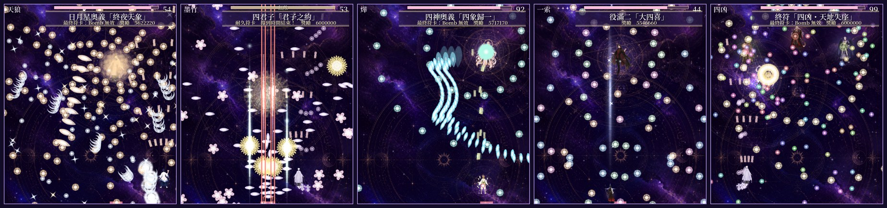
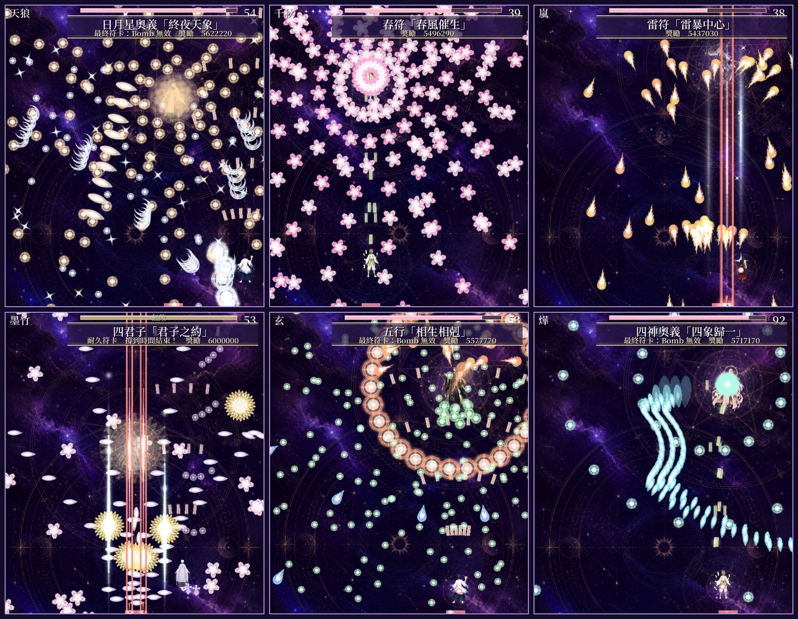
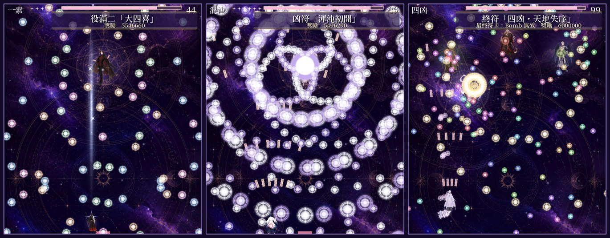
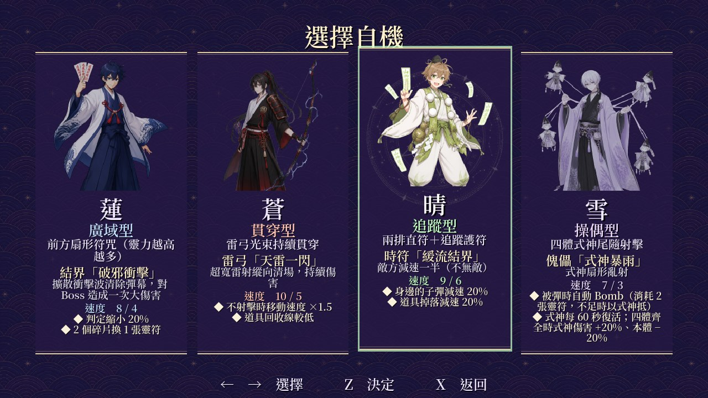
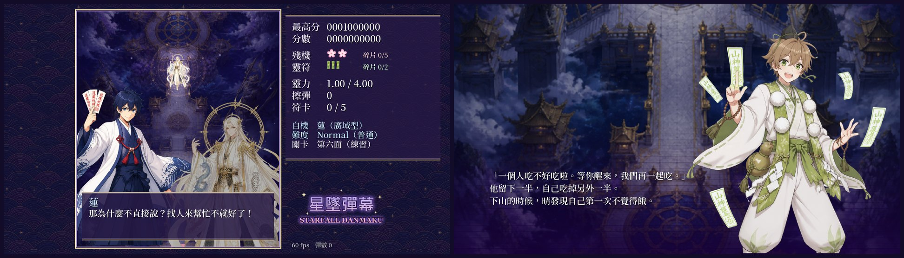
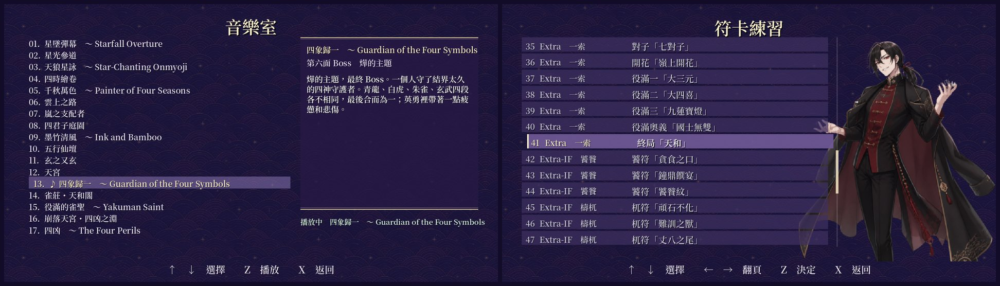

# 星墜彈幕 Starfall Danmaku

[English](README.md) · **繁體中文**

**星墜彈幕**是一款東方 Project 風格的縱向彈幕射擊遊戲。天門之夜，四個少年（驅魔師、弓術師、山伏、人偶師）穿過六面符卡，一路登上天宮。之後還有 Extra 關卡，以及「Extra-IF」路線：主角來不及趕到，四隻上古凶獸掙脫了封印。

這是我的副業專案。遊戲由我設計和主導，程式由 AI 程式代理 Claude Code 撰寫：先用 Unreal Engine 5.8（C++）做出第一版，再移植到 Godot 4.6（C#），也就是我現在遊玩和開發的版本。這一頁說明哪些是我做的、哪些是 AI 做的，以及遊戲的樣子。

> **關於音樂：** 遊戲裡的 17 首曲子全部是 AI 生成的暫用曲。我用提示詞生成它們，讓開發期間玩的時候有音樂可聽。之後我打算自己重新作曲，並推出更新版本；遊戲的其他內容（彈幕、立繪、音效）大致會維持現狀。

| | |
|---|---|
| **我的角色** | 遊戲設計、符卡設計、平衡調整、劇情方向（與 AI 程式代理合作的個人副業專案） |
| **時間** | 2026 年 11 月 6–10 日，約五天 |
| **工具** | Godot 4.6（C#）、Unreal Engine 5.8（C++，第一版）、Python、Blender；Claude Code、Canva（AI 圖像）、AI 音樂生成工具 |
| **試玩** | Windows 版（免安裝），以及 Lunatic、Extra、Extra-IF 三段錄影：[Releases](../../releases/latest) |

## 我的角色與 AI 的使用

### 1. 我自己的設計與決定

- **遊戲本身。** 我提出要做一款類東方的 STG，並以東方作為共同參考，一輪一輪回饋決定方向：符卡怎麼編排、Extra 關卡怎麼運作、難度該有什麼手感。
- **符卡。** 第二面的春夏秋冬四張符卡，來自我自己的 p5.js 彈幕原型。其他很多符卡也是我詳細設計或改寫的，例如：
  - **終局「天和」**：Extra Boss 的最後一張符卡，像最終 Boss 的最後符卡一樣分成三段：麻將牌組成的環從畫面上方射出（每一環有一半飛向天空），接著一排牌從底部隨機位置升起，最後是順時針的螺旋；每多一手，符卡名稱就疊加成「天和」「地和」「人和」。Boss 血量降到三分之一後計時才開始。
  - **役滿奧義「國士無雙」**：十三張 Bomb 清不掉的刺客牌，先放一張，之後每五秒放兩張。
  - **役滿二「大四喜」**：一次射出四個環，四種顏色、四種速度，會從畫面另一邊繞回來。
  - Extra-IF 凶獸的符卡，例如往相反方向轉的兩條尾巴、紅色月牙亂飛而白色衝向自機、吃下子彈後每一顆吐成三顆的饕餮。
- **結構與劇情。** 每一面的道中都不一樣；Extra 由前面出現過的 Boss 開場，勸玩家撤退；Extra Boss 和主線有關；對話隨劇情深入越來越長、越來越接近真相。**Extra-IF** 路線是我的點子：中國神話的四凶（饕餮、檮杌、混沌、窮奇）畫成美男子，每個自機在道中遇到不同的一隻，最後是車輪戰，每隻兩張符卡，再四隻一起上。
- **角色。** 每個自機的速度（例如蓮 8 / 4、蒼 10 / 5）和各兩個特性，例如蓮的判定較小、雪被彈時由式神代替放 Bomb。
- **系統。** 殘機與靈符碎片、每張符卡開始時三秒無敵、最後符卡免疫 Bomb 傷害、耐久符卡時 Boss 半透明且碰不到、東方式的靈力等級（每一級增加子彈），以及要在遊戲中遇到才會解鎖的符卡練習和音樂室。
- **寫作規範。** 我給 AI 一套對話寫作規範（自然的台灣華語、每一句話都要有說出口的理由、角色只能知道他有辦法知道的事），並讓所有對話依照規範重寫。
- **平衡。** 每個版本我都親自玩過，並給出具體的修改（「紅色環的間隔減半」「碎片速度減半」「血量 4000、計時 99 秒」），也用 bot 的測量數據確認哪些符卡在各難度太簡單或太難。
- **引擎。** 用 Unreal Engine 做了兩天後，我決定把遊戲搬到更適合 2D 遊戲的 Godot。

### 2. AI 生成的程式、美術與音效

- **程式。** 所有程式都是 Claude Code 依照我的要求寫的：Unreal Engine 的 C++ 版（11 月 6–7 日）、Godot 的 C# 移植（11 月 9 日，幾乎逐行翻譯），以及之後的每一次修改。它也寫了一個會自己玩遊戲的 bot，用來測量難度和錄製影片。
- **美術。** 立繪、角色圖、背景和子彈圖案是用 Canva 的 AI 圖像工具生成，再由 Python 腳本裁切、縮放、做成動畫（只有頭髮和衣襬會擺動的 sprite sheet）。最早的 Blender 卡通渲染已經被取代。
- **音效。** 音效（以及遊戲內建的備用音樂）是用 Python（NumPy、SciPy）合成的，腳本由 Claude Code 撰寫。
- **音樂。** 17 首曲子是我用 AI 音樂工具，依照每一面和每個 Boss 的主題提示詞生成的（見上方說明）。
- **文字。** 對話、結局、曲目介紹和英文翻譯，由 Claude Code 依照我的規範和修改意見撰寫。

### 3. 我測試了什麼

- 每個版本我都親自玩過，常常在符卡練習裡一張一張打，並把問題描述到可以修正的程度：還沒丟出麻將牌就先把人打死的瞄準線、Boss 根本沒碰到卻被撞死的衝刺、讓玩家完全打不到 Boss 的彈幕。
- 我請 AI 用 bot 跑過每個難度，並看結果：死亡數、Bomb 數，以及每張符卡有多少子彈從自機旁邊擦過。

### 4. 我目前還不會的事

- 我還寫不出 AI 生成的 C# 和 C++，例如子彈行為、bot 和繪圖的程式。
- 我還畫不出角色美術，也還沒有自己作曲；音樂是我第一個要改的部分。

## 遊戲畫面

**主線：天狼、千秋、嵐（上）；墨竹、玄、燁（下）**

**Extra 與 Extra-IF：大四喜、渾沌初開、四凶的最後符卡**

**四個自機，各有自己的射擊、Bomb、速度和特性**

**戰鬥前的對話，以及通關後的結局**

**音樂室與符卡練習**

## 遊戲特色

- **六面主線、Extra、Extra-IF。** 共 63 張符卡，包括耐久符卡和 Bomb 打不動的最後符卡。
- **四種難度。** Easy、Normal、Hard、Lunatic 改變彈數、間隔和速度，每個難度的道中也各自更密集。
- **四個自機。**

  | 自機 | 類型 | 速度（一般 / 低速） | Bomb |
  |---|---|---|---|
  | **蓮**，驅魔師 | 廣域型 | 8 / 4 | 擴散衝擊波清除彈幕，對 Boss 造成一次大傷害 |
  | **蒼**，弓術師 | 貫穿型 | 10 / 5 | 超寬的縱向雷射 |
  | **晴**，山伏 | 追蹤型 | 9 / 6 | 敵人和子彈減速一半（不無敵） |
  | **雪**，人偶師 | 操偶型 | 7 / 3 | 式神亂射；被彈時自動放 Bomb |

- **靈力等級。** 靈力每滿一級（1.00 到 4.00）就多一些子彈，跟東方一樣。
- **解鎖。** 符卡練習和音樂室一開始是鎖著的。在遊戲中遇到的符卡才會開放；還沒聽過的曲子顯示為 `？？？`，播放前會先提醒可能劇透。
- **劇情。** 每場戰鬥前後都有對話，每個自機都有自己的結局。
- **兩種語言。** 繁體中文和英文，在標題畫面切換。

## 製作方式

**流程。** 每一輪從我的回饋開始。Claude Code 修改程式、建置遊戲、讓 bot 打過相關的符卡或關卡，再把截圖或影片交給我檢查。

**Bot。** 自動駕駛會預測每一顆子彈接下來幾幀的位置，選最安全的走法。它用來確認每一關都打得過、測量每張符卡在各難度的危險程度，以及用 Godot 的 Movie Maker 錄影（錄影時的規則：符卡中不放 Bomb）。

**兩個引擎。** 第一版是 Unreal Engine 5.8 的 C++。之後幾乎逐行移植到 Godot 4.6，並用一個小小的相容層（`Godot/Scripts/Ue.cs`）讓程式寫法保持一致；[`Godot/PORTING.md`](Godot/PORTING.md) 列出每個檔案的來源。

| 資料夾 | 內容 |
|---|---|
| [`Godot/`](Godot) | 現在的遊戲：Godot 4.6 .NET 專案（C#）、美術、音效、字型 |
| [`Godot/Scripts/`](Godot/Scripts) | 關卡和符卡（`Stage*.cs`）、Boss 和劇情（`Bosses.cs`、`Story*.cs`）、bot（`Bot.cs`）、繪圖（`Hud.cs`） |
| [`Source/`](Source) | 最初的 Unreal Engine 5.8 C++ 版 |
| [`Tools/`](Tools) | 美術、sprite sheet、音效和翻譯表的 Python 腳本 |
| [`docs/`](docs) | [開發紀錄](docs/DEVLOG.md)和最初的設計說明 |

**執行方式。** 從 [Releases](../../releases/latest) 下載 Windows 版，或用 Godot 4.6.1（.NET）打開 `Godot/project.godot`。沒有放曲子的話，遊戲會改用內建的合成音樂。

## 學到的事

- **數字比形容詞有用。** 「太難了」很少換到我要的結果；「間隔減半」「間隔 30 度」「血量 4000」才有用。
- **難度要量，不要猜。** bot 統計的擦彈數，讓我看出哪些 Lunatic 符卡其實跟 Normal 差不多難，這點光靠我自己玩看不出來。
- **共同的參考很好用。** 說「像東方的音樂室」或「像那個 Extra Boss 的車輪戰」，是讓 AI 理解我意思最快的方法。
- **依遊戲選工具。** 2D 射擊遊戲用 Godot 建置、測試、發布，都比用 Unreal Engine 簡單。

## 製作名單

- **Sem Jia Le**：遊戲設計、符卡設計、主導，以及音樂（AI 生成，之後會換掉）
- **程式、音效與文字**：Claude Code（Anthropic），依照我的指示
- **字型**：Noto Serif TC（SIL Open Font License 1.1）
